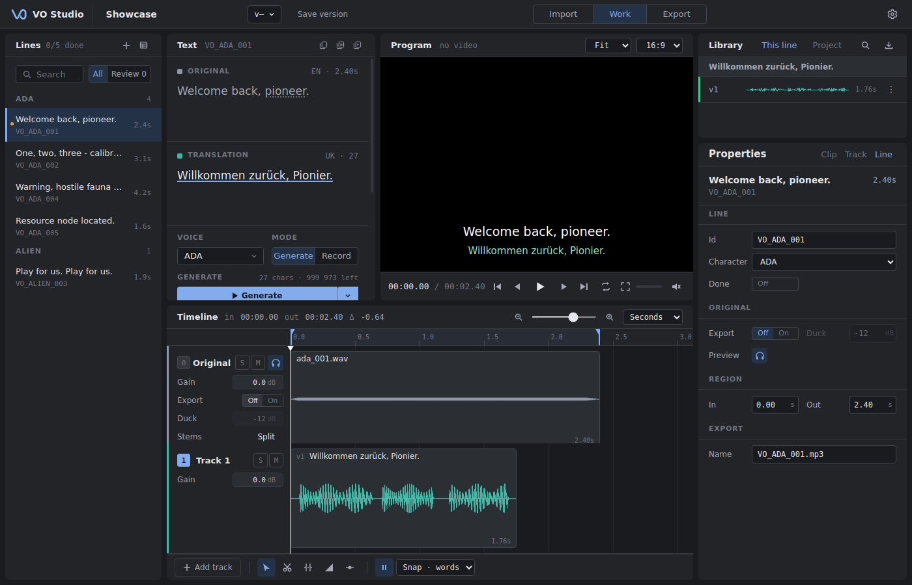
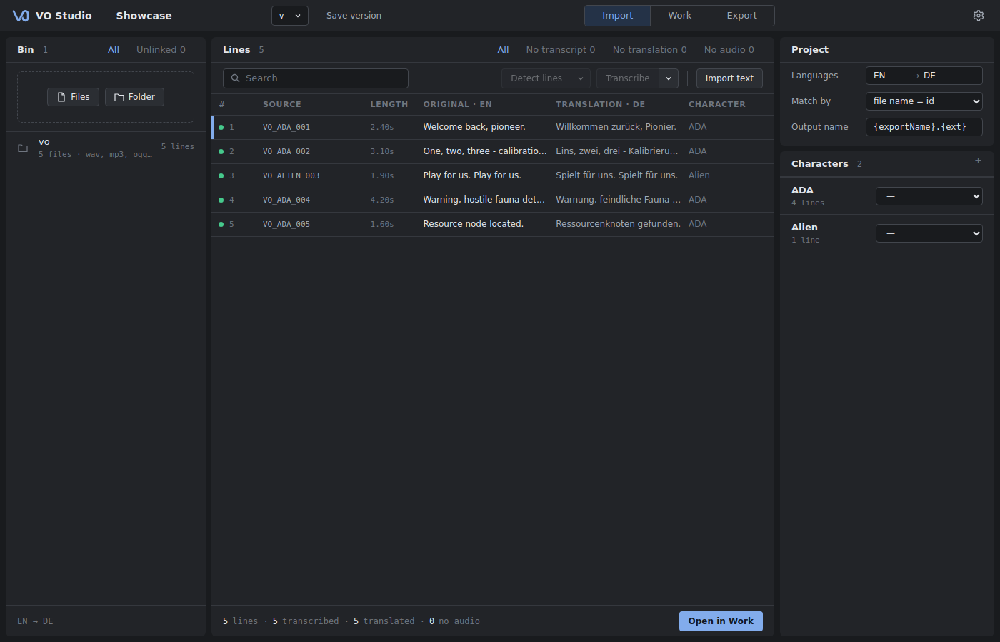

<div align="center">


# VO Studio

**Desktop studio for voice-over localization.**
Import original lines and audio, generate or record localized takes, edit them on a timeline, export delivery-ready files.

[](https://github.com/karauuul/VOStudio/actions/workflows/ci.yml)
[](https://github.com/karauuul/VOStudio/releases/latest)

</div>



## Features

**Import**
- Audio (`wav`, `mp3`, `ogg`, `flac`, `m4a`, `aac`, `opus`, `webm`) and video (`mp4`, `mov`, `mkv`, …) as sources; a long recording or video becomes one source with many line regions.
- Line tables from `csv`, `tsv` and `xlsx` with a column-mapping preview; plain text where every paragraph becomes a line.
- Project templates (`.vostudio-src`) with characters, terms and reference audio; re-import by line id keeps existing work.
- Transcription and line detection on long sources.

**Work**
- Per-line timeline: the original lane with preview, export mode, ducking and stem split, plus any number of tracks with mute, solo, gain and a target track.
- Generate speech from the translation, the selected words or a selected clip; voice-to-voice from a recording. Every result is a versioned source in the library and a clip on the timeline.
- Recording streamed to disk with crash recovery, 16 or 24-bit, punch and roll with pre-roll and latency compensation, loop record where every pass is a take.
- Clips carry per-word timings: cut at words, trim, fade, ripple delete, move groups.
- Effects on clips, sources and tracks: gate, high-pass, EQ, compressor, pitch, reverb, delay.
- Glossary with term highlighting, characters with voices, review and done states.
- Non-destructive: takes are never overwritten, every edit is undoable, project versions can be saved and restored.

**Export**
- Readiness table with ready, changed and not-ready lines; export all or only what changed.
- Formats: same as source, WAV 48 kHz / 24-bit, WAV 44.1 kHz / 16-bit, MP3 192 kbps, OGG.
- Loudness: match original, target LUFS or peak; LUFS targets never push peaks above −1 dBFS.
- Video export with the localized audio muxed in; delivery package with an updated `index.csv` and a report.

**Agent API**
- Built-in MCP server: Claude Code, Codex, Claude Desktop or any MCP client drives the open project live, with every change undoable.
- Command-line client and a headless mode for scripted runs. See [docs/agent.md](docs/agent.md).



## Install

Windows installer: [latest release](https://github.com/karauuul/VOStudio/releases/latest). Installed builds update themselves.

Speech generation, voice-to-voice, transcription and stem split use [ElevenLabs](https://elevenlabs.io). Enter an API key in **Settings**; it is encrypted by the operating system (Electron `safeStorage`) and never written to project files. Recording, editing and export work without a key.

## Quick start

1. **New** for an empty session, or **Import template** for a prepared project.
2. **Import** (`Ctrl+1`): add audio, video or a line table; assign voices to characters.
3. **Work** (`Ctrl+2`): pick a line, then **Generate** or **Record**; edit the result on the timeline.
4. Mark lines **Done** as they are approved.
5. **Export** (`Ctrl+3`): choose folder, format and loudness, then **Export**.

All shortcuts are listed in the app (`F1`) and in [docs/design/README.md](docs/design/README.md#hotkeys).

## Project data

A project is a folder `<name>.vostudio/` containing `project.json` (cues, takes, compositions) and `ui.json` (view state). Audio takes are stored beside it. The template format is specified in [docs/template-format.md](docs/template-format.md).

## Development

Requires Node.js 22.

```
npm ci
npm run dev        # dev app with HMR
npx tsc --noEmit   # typecheck
npm test           # vitest
npm run build      # electron-vite production build
npm run package    # build + electron-builder → release/win-unpacked
```

`VOSTUDIO_PROVIDER=mock` replaces the voice provider with an offline mock, so generation and transcription run without a key or network.

Releases are built by GitHub Actions from `v*` tags. Every change must pass the gates listed in [AGENTS.md](AGENTS.md): typecheck, the full test suite and a production build.

Example converter — turns a game export into a project template, outside the app:

```
node scripts/convert-satisfactory.ts --csv <master_vo_table.csv> --audio <original_audio dir> --out <name.vostudio-src>
```

### Stack

Electron 33 · electron-vite · React 18 · TypeScript · zod · zustand · Web Audio API · ffmpeg-static (encoder only). No other runtime dependencies; reverb, delay and pitch shifting are implemented on Web Audio / AudioWorklet.

### Layout

- `src/main/` — Electron main process.
  - Project store (`project-store.ts`, atomic writes, autosave, versions), IPC handlers and zod validation (`index.ts`, `schemas.ts`).
  - Export encoding and video mux (`export.ts`, `ffmpeg.ts`); audio, table and long-source import (`audio-import.ts`, `table-import.ts`, `sources.ts`, `template-import.ts`).
  - Provider adapters (`providers/elevenlabs.ts`, offline `providers/mock.ts` selected by `VOSTUDIO_PROVIDER=mock`, both behind `providers/voice-provider.ts`); API keys via `safeStorage` (`secrets.ts`).
  - Agent API: MCP server and tools (`agent/`), stdio bridge and CLI (`bridge.ts`).
- `src/shared/` — pure logic, no Electron and no DOM: data model (`domain.ts`), composition math and tracks (`comp.ts`), library groups, versions, clip placement and track helpers (`library.ts`), generation target (`generation.ts`), effect params and clamps (`effects.ts`), pitch math (`pitch.ts`), export planning and settings (`export-plan.ts`, `export-settings.ts`), readiness (`readiness.ts`), subtitles (`subtitles.ts`), long sources and regions (`sources.ts`), table import mapping (`import-table.ts`), queue filters (`cue-filter.ts`), IPC types (`ipc.ts`).
- `src/renderer/` — React UI and audio engine.
  - Shell and rooms: `App.tsx` (project lifetime, shared state), `useProjectSession.ts` (snapshot, dispatch, draft flush), `shell/` (`TopBar.tsx`, `Logo.tsx`, `ContextMenu.tsx`, `HotkeyHint.tsx`), `rooms/` (`ImportRoom.tsx`, `WorkRoom.tsx`, `ExportRoom.tsx`), `ProjectHome.tsx`, `StatusToast.tsx`.
  - Work room: `work/LinesPanel.tsx`, `work/TextPanel.tsx` (original, translation, generator grid), `work/ProgramPanel.tsx` (monitor, transport, Source mode), `work/TimelinePanel.tsx` (lanes, tracks, clips, tools), `work/LibraryPanel.tsx`, `work/PropertiesPanel.tsx`; `Waveform.tsx` (peaks cache), `playback.ts` (transport relay), `keyboard.ts` (`e.code` dispatcher with focus scopes).
  - Import room: `import/SourcesPanel.tsx`, `import/LinesTable.tsx`, `import/ProjectPanel.tsx`; `import/TableImportDialog.tsx` (table and script preview with column mapping, opened from Import and Work).
  - Export room: `export/OutputPanel.tsx`, `export/ReadinessTable.tsx`, `export/SummaryPanel.tsx`, `export/run-export.ts` (`runJob` / `runPlan`).
  - Overlays: `Overlay.tsx` (one manager), `SettingsDialog.tsx`, `ShortcutsDialog.tsx`, `JobsDrawer.tsx`, `RulesPanel.tsx`, `MigrationDialog.tsx` (legacy recovery, unmounted).
  - `cue/` — timeline math and drawing helpers, composition edit history, recording and voice-to-voice hooks, drag number field.
  - `audio/` — `clip-graph.ts` (`buildClipGraph` / `scheduleComp`, the only place audio node chains are built), `transport.ts` (live playback), `offline-render.ts` (export rendering), `comp-source.ts`, `stems.ts`, `recorder.ts`, `duration-queue.ts`, `lru.ts`; `audio/worklets/` and `worklets/` (AudioWorklet sources, delivered as Blob URLs).
  - `jobs/` (queue and store), `api.ts` (typed IPC bridge and audio URLs).
  - `styles/` — `tokens.css`, `shell.css`, `base.css`, `work.css`, `import.css`, `export.css`, `overlays.css`; `app.css` imports them in that order.
- `tests/` — vitest, pure logic only.

## Documentation

- [docs/design/README.md](docs/design/README.md) — design spec: mocks, rules, hotkeys; [docs/design/model.md](docs/design/model.md) — data model behind the screens
- [docs/template-format.md](docs/template-format.md) — project template import/export format
- [docs/agent.md](docs/agent.md) — agent API: in-app MCP server, connecting clients, CLI, headless mode, tools and prompts
- [AGENTS.md](AGENTS.md) — contributor and agent rules, including the invariants any change must preserve
